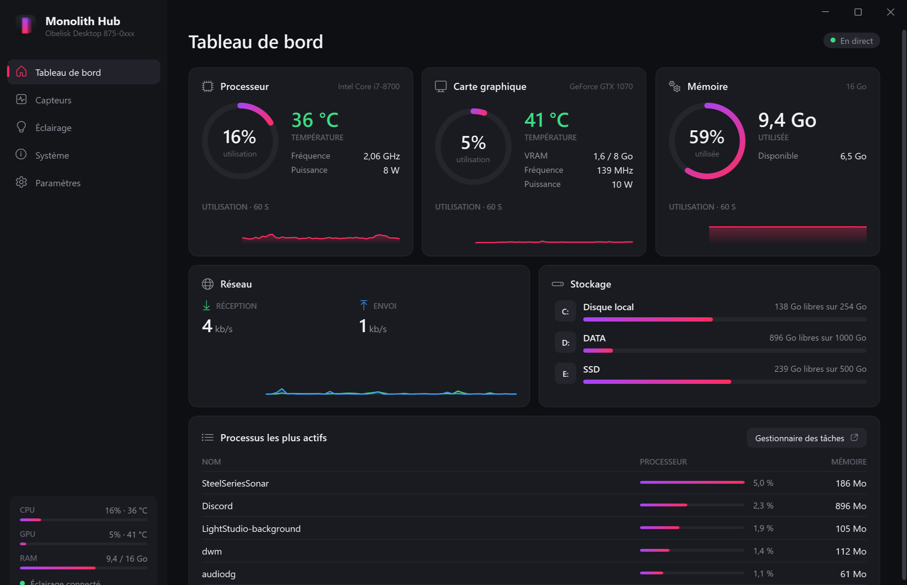
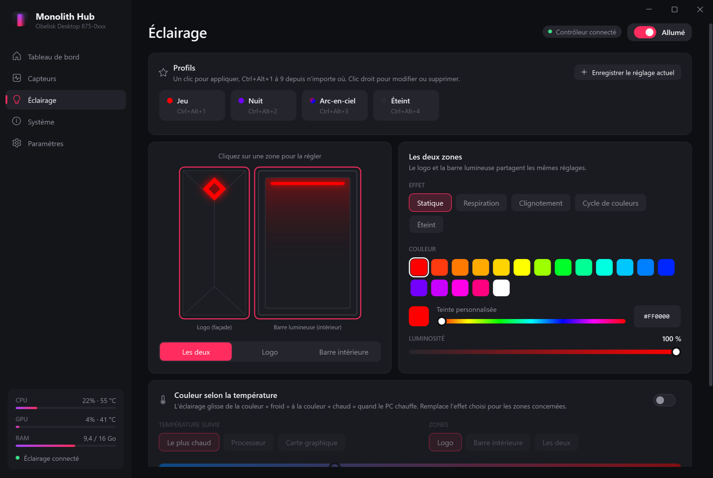
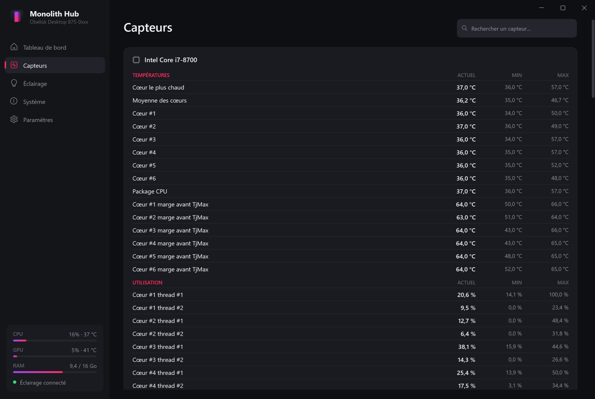
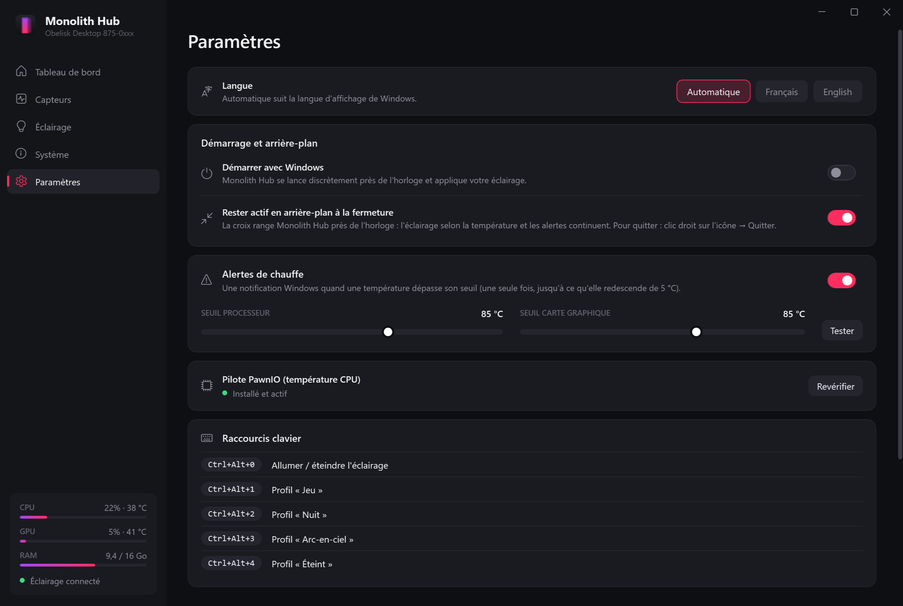
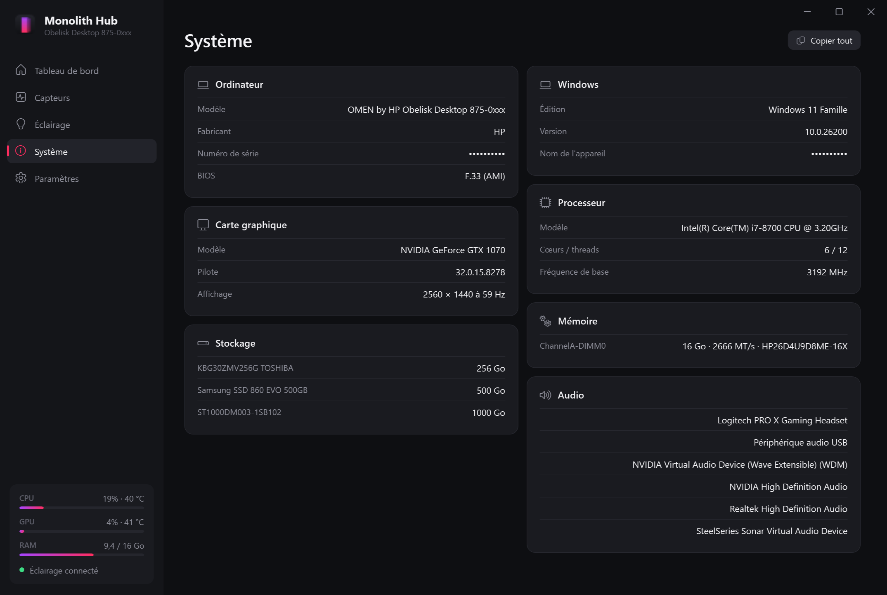

<p align="center">
  
</p>

<h1 align="center">Monolith Hub</h1>

<p align="center">
  <b>Monitoring et éclairage pour PC HP OMEN - une alternative légère à l'OMEN Gaming Hub, sans publicité.</b><br>
  <sub>Projet communautaire indépendant, non affilié à HP Inc.</sub>
</p>

<p align="center">
  <a href="../../releases/latest">Télécharger</a> ·
  <a href="#fonctionnalités">Fonctionnalités</a> ·
  <a href="#compatibilité">Compatibilité</a> ·
  <a href="#faq">FAQ</a> ·
  <a href="#english">English</a>
</p>



## Pourquoi Monolith Hub ?

L'OMEN Gaming Hub fait beaucoup de choses, mais il est lourd, lent à démarrer et rempli d'offres et de publicités.
Monolith Hub ne garde que l'essentiel - **voir l'état de son PC et régler son éclairage** - dans une application native,
rapide et discrète.

## Fonctionnalités

**Monitoring**
- Utilisation, température, fréquence et puissance du **CPU** et du **GPU**, mémoire, VRAM
- Graphiques des 60 dernières secondes, réseau (réception / envoi), espace disque
- Processus les plus gourmands
- Page **Capteurs** : tous les capteurs avec valeurs min / max et recherche
- Page **Système** : modèle, BIOS, processeur, carte graphique, barrettes de RAM, disques, audio

**Éclairage** (logo en façade et barre lumineuse intérieure)
- Effets **statique, respiration, clignotement, cycle de couleurs** ou éteint, par zone ou les deux ensemble
- Aperçu animé du boîtier, palette de couleurs, teinte personnalisée, luminosité, vitesse
- **Profils** (Jeu, Nuit, Arc-en-ciel, Éteint… et les vôtres) avec raccourcis **Ctrl+Alt+1…9**, **Ctrl+Alt+0** pour tout allumer / éteindre
- **Couleur selon la température** : l'éclairage glisse de la couleur « froid » à la couleur « chaud » quand le PC chauffe

**Au quotidien**
- Icône près de l'horloge : températures au survol, éclairage et profils au clic droit
- **Alertes de chauffe** : notification Windows quand le CPU ou le GPU dépasse le seuil choisi
- Démarrage avec Windows (réduit), consommation quasi nulle quand la fenêtre est fermée
- **Français et anglais** : langue de Windows détectée automatiquement, modifiable à chaud dans les Paramètres
- Reconnexion automatique du contrôleur, éclairage remis après une mise en veille

<table>
  <tr>
    <td></td>
    <td></td>
  </tr>
  <tr>
    <td></td>
    <td></td>
  </tr>
</table>

## Compatibilité

| | |
|---|---|
| Système | Windows 10 (1809+) ou Windows 11, 64 bits |
| Monitoring | Tous les PC (CPU Intel / AMD, GPU NVIDIA / AMD / Intel) |
| Éclairage | Contrôleur USB HP `103C:84FD` : **OMEN Obelisk 875** (testé), OMEN 30L (même contrôleur, non testé) |

Sur un autre modèle, l'éclairage est simplement indiqué comme non pris en charge : tout le reste fonctionne.
Votre modèle n'est pas reconnu ? [Ouvrez un ticket](../../issues) en joignant le journal (Paramètres → À propos → Ouvrir le journal).

## Installation

1. Téléchargez **`Monolith-Hub-Setup-x.y.z.exe`** depuis la [dernière release](../../releases/latest)
   (ou la version portable `.zip`, à décompresser n'importe où).
2. Lancez-le. Monolith Hub n'étant pas signé numériquement, Windows peut afficher
   « Windows a protégé votre ordinateur » : cliquez sur **Informations complémentaires → Exécuter quand même**.
3. Monolith Hub demande les droits administrateur à chaque lancement : ils sont nécessaires pour lire les capteurs.

> **Contrôle intelligent des applications (Windows 11)** - si cette protection est activée sur votre PC, Windows
> bloque les programmes non signés numériquement, ce qui est encore le cas de Monolith Hub. La signature du code est prévue ;
> en attendant, l'installation n'est possible que si la protection est désactivée
> (Sécurité Windows → Contrôle des applications et du navigateur).

> **Température du CPU** - elle nécessite le pilote gratuit et open source [PawnIO](https://pawnio.eu).
> L'installateur propose de l'installer (case cochée par défaut, décochez-la si vous n'en voulez pas).
> S'il manque plus tard, Monolith Hub l'indique et propose de l'installer en un clic.

Le runtime .NET est inclus : rien d'autre à installer.

**Désinstaller** : depuis Paramètres Windows → Applications, ou dans Monolith Hub : Paramètres → À propos → *Retirer Monolith Hub de Windows*.

## FAQ

**Faut-il désinstaller l'OMEN Gaming Hub ?**
Ce n'est pas obligatoire, mais s'il reste ouvert il peut réimposer ses propres couleurs. Monolith Hub signale quand le
contrôleur d'éclairage est occupé par une autre application et reprend la main dès qu'il est libéré.

**Pourquoi les droits administrateur ?**
La lecture des températures et fréquences du processeur passe par un pilote noyau ; Windows exige pour cela une
application lancée en administrateur. Le démarrage automatique utilise une tâche planifiée pour éviter une demande
d'autorisation à chaque ouverture de session.

**Où sont mes réglages ?**
Dans `%APPDATA%\MonolithHub` (réglages et journal). Les versions « OMEN Lite » précédentes sont reprises automatiquement.

**Monolith Hub envoie-t-il des données ?**
Non. Aucune télémétrie, aucune connexion réseau, à l'exception de l'installation de PawnIO si vous la demandez.

## Compiler depuis les sources

Prérequis : [SDK .NET 8](https://dotnet.microsoft.com/download/dotnet/8.0) et, pour l'installateur,
[Inno Setup 6](https://jrsoftware.org/isinfo.php) (`winget install JRSoftware.InnoSetup`).

```powershell
# Lancer en développement
dotnet run --project MonolithHub

# Produire l'installateur et la version portable dans .\artifacts
.\build.ps1
```

Organisation du code :

| Dossier | Contenu |
|---|---|
| `MonolithHub/Hardware` | Capteurs (LibreHardwareMonitor), informations système, pilote PawnIO |
| `MonolithHub/Lighting` | Protocole du contrôleur USB, effets, profils, réglages |
| `MonolithHub/Shell` | Zone de notification, raccourcis globaux, alertes, nettoyage |
| `MonolithHub/Controls` | Jauges, graphiques, sélecteurs de couleur |
| `MonolithHub/Resources` | Textes de l'interface : `Strings.resx` (anglais), `Strings.fr.resx` (français) |
| `installer` | Script Inno Setup |

**Ajouter une langue** : copiez `MonolithHub/Resources/Strings.fr.resx` en `Strings.<code>.resx` (par ex. `Strings.de.resx`),
traduisez les valeurs, ajoutez le code à `SatelliteResourceLanguages` dans `MonolithHub.csproj` et un bouton dans
la carte « Langue » des Paramètres. Les contributions sont les bienvenues.

## Licence et crédits

Monolith Hub est distribué sous [licence MIT](LICENSE). Il s'appuie sur
[LibreHardwareMonitor](https://github.com/LibreHardwareMonitor/LibreHardwareMonitor) et
[HidSharp](https://www.zer7.com/software/hidsharp) ; le protocole du contrôleur d'éclairage a été documenté par le
projet [OpenRGB](https://gitlab.com/CalcProgrammer1/OpenRGB). Détails dans [THIRD-PARTY-NOTICES.md](THIRD-PARTY-NOTICES.md).

HP et OMEN sont des marques de HP Inc. Monolith Hub est un projet indépendant, non affilié à HP Inc., ni approuvé ou
soutenu par HP Inc. Les noms de produits servent uniquement à indiquer la compatibilité.

---

## English

**Monolith Hub** is a lightweight, ad-free alternative to OMEN Gaming Hub for HP OMEN desktops: hardware monitoring
(CPU, GPU, RAM, storage, network, all sensors) and lighting control (logo and light bar: static, breathing, blinking,
color cycle, profiles with global hotkeys, temperature-reactive color), plus overheating alerts and a tray icon.
The interface is available in English and French (follows the Windows language, switchable in Settings).

Lighting works with the HP USB controller `103C:84FD` (OMEN Obelisk 875, likely OMEN 30L). CPU temperature requires the
free [PawnIO](https://pawnio.eu) driver. Download the installer from the [latest release](../../releases/latest).
MIT licensed. Not affiliated with HP Inc.
